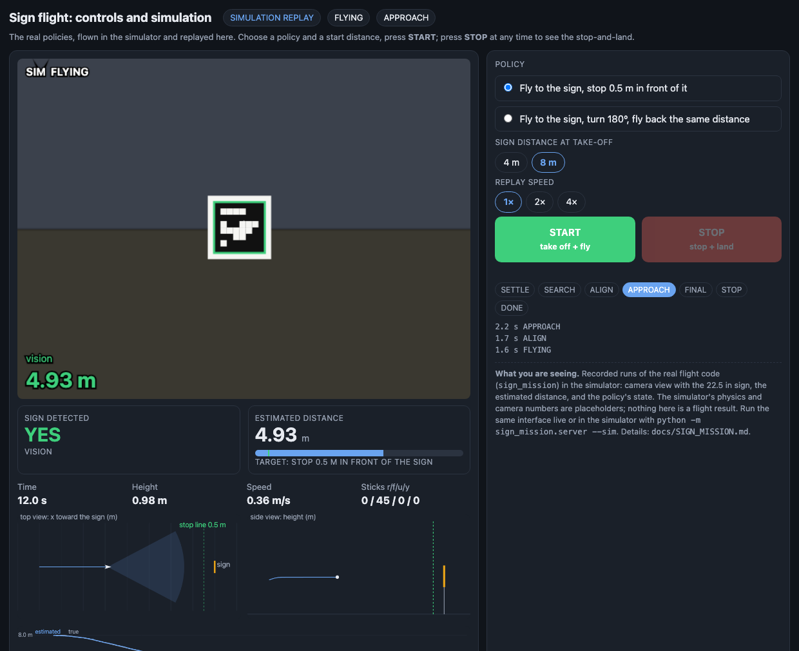

# Sign Flight: a Tello that flies to a sign, stops half a metre in front of it, and lands

*Point a small drone at a printed sign. Press Start. It takes off, flies to the sign, stops 0.5 m in front of it, and lands, all by itself.
A second mode turns around at the sign and flies the same distance back.*



> **Status: proven in simulation, not yet flown.** The code is tested end to end against a simulated Tello and a fake drone link (116 automated tests).
> The first real flights are the next step, and the repo ships a safe way to begin (see "Try it").

## What it does

- **One button, whole mission.** Start takes off, finds the sign, flies to it, and stops **0.5 m in front** of the 22.5 in sign. Then it lands softly. Stop works at any moment: the drone stops where it is and lands.
- **Fly out and back.** The second policy does the same, then turns exactly 180 degrees and flies back the same distance to where it started, and lands.
- **A control page anyone can use.** Live drone video, a clear "sign detected" light, the estimated distance with its uncertainty, and the two big buttons. It runs in any browser.
- **Look before you fly.** *Shadow mode* runs the whole policy on the drone's live video without ever taking off: carry the drone toward the sign by hand and watch what it would do.
- **A demo site that needs nothing.** One HTML file (`docs/sign_demo/index.html`): the same controls, the simulated camera, top and side views, and a distance chart. Press Stop mid-flight and watch the landing.

## Why it is interesting

- **It stops where the camera can no longer see.** A 22.5 in sign stops fitting in the drone's image about 0.74 m away, so the last stretch to 0.5 m is flown
  on a distance filter driven by the drone's own speed. In simulation it stops within a few centimetres of the target.
- **It learns the drone while it flies.** Nobody knows exactly how fast a particular Tello moves per stick unit. The policy measures it from how fast the sign appears to approach, so a drone
  twice as fast or half as fast as assumed still stops in the right place.
- **A distance estimate you can trust.** A Kalman filter roughly halves the frame-to-frame distance error and cuts the worst single misreading 2-3x,
  and it carries on through missed frames and outliers.
- **Safety is a feature, not an afterthought.** Every stick is capped. Start refuses to take off on a low battery, without video, or if the drone is already airborne. A live Start needs a
  confirmation ("area clear, catcher ready"). Stop always ends in a gentle landing. The mission aborts and lands on lost telemetry, a sign that never shows up, a distance that does not
  shrink, or a runaway timer. The motor-cut command is never used.
- **One sign, nothing else.** No second tag to wait for or search for. Turning around is done on measured heading and distance alone.

## How it works, in one picture

```
 take off -> settle -> search (if needed) -> centre the sign -> approach (speed follows distance)
          -> creep the last 0.4 m on the filter -> stop and hold 0.5 m -> descend gently -> land
 out-and-back adds:  ... stop at the sign -> turn 180 deg -> fly the same distance back -> stop -> land
```

| Piece | What it does |
|---|---|
| Distance estimator | pose + size cues, Kalman filter on the drone's speed, dead reckoning when the sign is too close to see |
| Approach policy | holds heading, keeps the sign centred with the side stick (absorbs light cross-wind), brakes on a curve that allows for the command lag |
| Out-and-back policy | turn 180 deg by telemetry yaw, return the distance measured on the way out |
| Landing policy | brake, settle, descend straight down, then the Tello `land` command; lands immediately if the height stops falling |
| Mission runner | the only thing that sends sticks; sequences take-off, policy and landing; watchdogs and Start/Stop |
| Control interface | video, detection, distance, Start/Stop; simulation or the real drone behind the same page |

## Numbers (simulation)

Measured against the simulator's true position, normal conditions and light wind (0.5 m/s):

| | Result |
|---|---|
| Stop distance, sign 3-12 m away, sideways offset, heading error | 0.50-0.53 m from the sign |
| Drone half / twice as fast as assumed, delayed video, noisy corners | same |
| Distance error with 1 px corner noise, filter vs a single frame | about 2x lower (8 m: 6.5 cm vs 12.8 cm RMSE) |
| Out-and-back return error, no wind | typically 0.05-0.4 m after an 8 m leg |
| Automated tests | 116 passing |

These are simulator results with placeholder physics. They show that the logic works, not how the real drone behaves.

## Try it

```bash
cd Drone_Racing
open docs/sign_demo/index.html                              # the demo site, nothing to install
.venv-sim/bin/python -m sign_mission.server --sim           # live interface on a simulated drone: http://127.0.0.1:8765
.venv-sim/bin/python -m sign_mission.server --live --shadow # the real drone's camera, no take-off, no sticks sent
.venv-sim/bin/python -m pytest tests/test_sign_mission.py   # the mission tests
```

## What you need for a real flight

A Tello, a printed sign with a **measured** 22.5 in black square (hung flat, about 1 m high, with free space around it), a laptop on the drone's Wi-Fi, and a person with a catcher.
The drone has **no obstacle sensing**: keep its path empty. Follow the ordered checklist in [SIGN_MISSION.md](SIGN_MISSION.md): measure the sign, calibrate the camera, shadow mode first, then a short course.

## What is next

First flights and calibration (real speed per stick, camera, telemetry units), wind handling for the out-and-back return, and a second sign type or moving target if the event needs one.

Details: [SIGN_MISSION.md](SIGN_MISSION.md) (guide, safety, limits) · [figures/sign_range_accuracy.png](figures/sign_range_accuracy.png) (distance accuracy) · `sign_mission/` (code).
