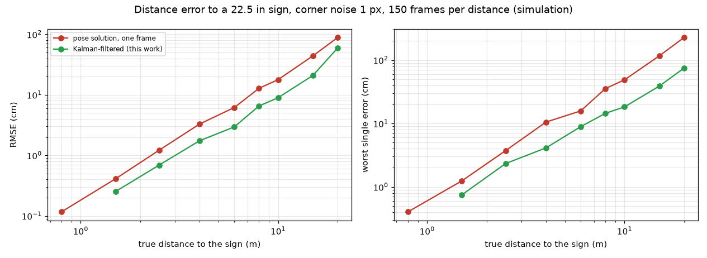

# Fly to the sign, stop 0.5 m in front of it, land

Everything for the real drone (and its simulation) is in the package `sign_mission/`. One command starts a web control
interface; the same interface drives either a simulated Tello or the real one.

**Status: tested in simulation only (115 tests, normal conditions and light wind). Nothing has been flown yet.** All
dynamics and camera numbers are placeholders until you fly the calibration steps below.

## What you get

| Item | Where |
|---|---|
| Control interface: video, sign detected yes/no, estimated distance, **Start** (take off + run the policy), **Stop** (stop + land) | `python -m sign_mission.server` |
| Policy 1: take off, fly to the sign, stop 0.5 m in front, land, in one go | `ApproachPolicy` (`approach`) |
| Policy 2: the same, then turn 180 degrees, fly back the same distance, land | `OutAndBackPolicy` (`out_and_back`) |
| Landing policy: stop, settle, descend gently, then the Tello `land` command | `LandingPolicy` |
| Better distance estimate for a 22.5 in sign | `SignRangeEstimator` |
| Shadow mode: the policy runs on live video but nothing is sent to the drone | `--shadow` |
| Demo website: the controls and the simulation of both policies, no install needed | [docs/sign_demo/index.html](sign_demo/index.html) (open in a browser) |

There is **one sign**. Nothing waits for or searches for a second tag; after the turn in policy 2 the return leg is flown
on distance alone.

## Run it

```bash
# setup (once): uv venv --python 3.11 .venv-sim && uv pip install --python .venv-sim/bin/python -r requirements-sim.txt \
#               opencv-python pupil-apriltags && uv pip install --python .venv-sim/bin/python -e cal_and_map

.venv-sim/bin/python -m sign_mission.server --sim            # simulation, open http://127.0.0.1:8765
.venv-sim/bin/python -m sign_mission.server --live --shadow  # real drone, camera and policy only: it will NOT take off
.venv-sim/bin/python -m sign_mission.server --live           # real drone: Start takes off
```

Options: `--sign-width-in 22.5`, `--tag-id N` (only this tag is the sign), `--stop-m 0.5`, `--iface wlx...` (pin to a Wi-Fi stick, Linux),
`--trust-velocity` (see "Measure first"), `--sim-speed 4` (simulation faster than real time), `--token` (needed to expose a live drone beyond localhost).
Tests: `.venv-sim/bin/python -m pytest tests/test_sign_mission.py`.

## The demo website

`docs/sign_demo/index.html` is a single file (about 300 KB, no internet needed). It has the same control panel as the live interface (policy choice,
**Start**, **Stop**) and shows the simulated camera with the 22.5 in sign and the detection, the estimated distance against the target, top and side
views, and a distance-over-time chart. It replays recorded runs of the real flight code in the simulator for both policies at 4 m and 8 m. **Stop**
switches to a recording of the stop-and-land that was run from that moment (recorded every 1.5 s of flight). Rebuild it after any policy change with
`.venv-sim/bin/python scripts/build_sign_demo.py` (about a minute). To fly the same interface live or in the simulator instead of replaying, use `python -m sign_mission.server`.

## What the policy does

```
take off -> SETTLE -> (SEARCH: turn slowly until the sign is seen) -> ALIGN (centre it) -> APPROACH (speed follows distance)
   -> FINAL (sign too close to see completely: creep on the distance estimate) -> STOP (hold 0.5 m) -> DONE -> LANDING
policy 2:  ... STOP -> TURN (180 deg by telemetry yaw) -> RETURN (same distance) -> STOP2 -> DONE -> LANDING
```

- **Stop distance:** 0.5 m from the camera to the sign plane, measured along the viewing direction. The Tello's props are a few centimetres behind the camera.
- **Why the last stretch is estimated:** a 22.5 in sign stops fitting in the 960x720 image at about 0.74 m, and the detector needs all four corners. From about 0.93 m the distance comes from the filter running on the drone's own speed, not from a new detection.
- **Safety limits (the mission aborts and lands):** session time 150 s, height above 2.4 m, no height or yaw telemetry for 2 s, battery below 12 %, the distance not closing while it should, flying much farther than the sign was, turn or return taking too long, sign never found after a full turn.
- **Stop button:** works in every flying phase and always ends in the landing policy. It never uses the motor-cut command (that is for a person with a hand on the drone).
- **Landing:** brake, settle, descend straight down at a fixed gentle rate to 0.35 m, then `land`. If the height does not fall it sends `land` at once. A landing that is not confirmed is reported loudly ("catch the drone").
- **Global stick cap** 60 (the policies use less). Rejects Start for low battery (<20 %), no telemetry, no video, or a drone already in the air; a live Start needs the "area clear, catcher ready" tick.

## The distance estimate (task 3)

| Piece | What it does |
|---|---|
| Sign size | 22.5 in = 0.5715 m, taken as the **edge of the black square** (the AprilTag convention). If your 22.5 in includes a white margin, the true square is smaller and every distance reads too long, so the drone stops **closer** than 0.5 m. Measure the black square and pass `--sign-width-in`. |
| Three cues | pose-solution depth, width and height of the sign in pixels; used as a consistency check and flip guard |
| Kalman filter | driven by the drone's own forward speed; smooths frame noise, bridges missed frames, rejects single outliers (4-sigma gate) |
| Near field | below about 0.93 m the sign leaves the image: dead reckoning with a growing uncertainty |
| Speed per stick unit | learned during the approach from how fast the camera sees the sign close in, so a drone faster or slower than assumed still stops correctly |

Measured in simulation (150 frames per distance, `scripts/sign_range_accuracy.py`, corner noise 1 px): filtering roughly **halves the error and cuts
the worst single error 2-3x** (8 m: 12.8 cm to 6.5 cm RMSE; 15 m: 44 cm to 21 cm). Averaging the cues does **not** help single frames (they share the corner noise);
a small common pose bias of about 1 % remains. 

## Simulation results (what "works" means here)

Full loop through the real controller code, distance error of the stop measured against the true position:

| Conditions | Result |
|---|---|
| sign 2-15 m away, 1 m sideways, 15 deg heading error | stops 0.50-0.53 m from the sign, lands (policy 1) |
| true drone half or twice as fast as assumed, stick deadband 4, delayed video, noisier corners | same |
| light cross-wind 0.5 m/s, light head/tailwind 0.3 m/s | stops within 0.1 m of the target |
| policy 2, no wind | turns 180 deg (+-6), returns to within 0.6 m of the start (typically 0.05-0.4 m) and lands |
| real detector on rendered images (3 m) | same as above |

**Limits found, not fixed:** a 0.5 m/s wind blowing toward the sign still pushes the drone to the sign while landing in the simulation; policy 2's return
drifts (about 1.4 m after 8 m in 0.5 m/s cross-wind) because once the sign is behind the drone there is no reference. The simulated drone has no position hold, which a real Tello has, so
these are probably pessimistic, but the real values are unknown. Policy 2 distance accuracy without wind: within about 0.2-0.4 m after an 8 m leg.

## Before the first flight (do these in order)

1. **Measure the black square of the printed sign** and pass `--sign-width-in`. Hang it with its centre about 0.8-1.2 m above the ground, flat, facing the take-off spot, with 1 m of free space around it and nothing behind it that the drone could hit. The drone has **no obstacle sensing**.
2. **Camera calibration:** `config/camera/default.yaml` is a copy from another drone. Calibrate yours (`cal_and_map`) and replace it.
3. **Shadow mode** (`--live --shadow`): carry the drone by hand toward the sign. Check the "sign detected" light, that the distance matches a tape measure at 1, 2, 4 m, and that the state chips and sticks make sense (forward while far, nothing inside 0.5 m). Nothing is sent to the drone.
4. **Measure first, then trust:** on the drone, check that telemetry yaw grows when it turns clockwise (`yaw_sign`), and what units `vgx`/`vgy` use (`--trust-velocity --vel-scale ...` only after this). Without it, the policies dead-reckon on commanded sticks and the learned speed scale.
5. **Props-off or tethered** run of Start/Stop to see that the sticks and the take-off/land commands reach the drone.
6. **Free flight, short course first** (3 m), catcher ready, battery above 60 %, calm air, then 8 m, then policy 2. Press **Stop** at any time; also keep the remote/flip-over cut-off in mind (flip the drone upside down to cut the motors).

Not yet verified on hardware: all of the above in flight, the 22.5 in print size, real stopping behaviour, Wi-Fi/video range, `vgx`/`vgy` units, whether `takeoff`/`land` replies arrive in time.
