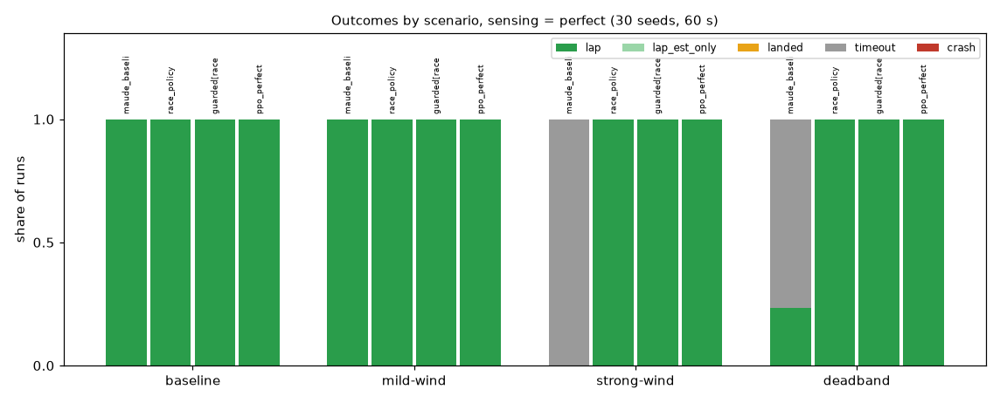
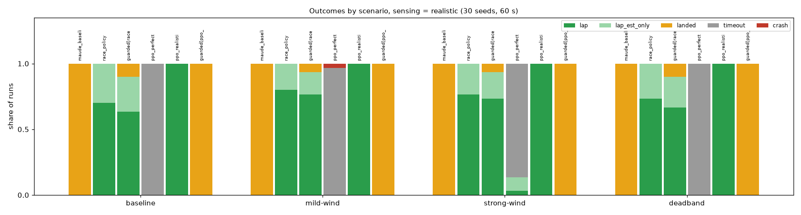
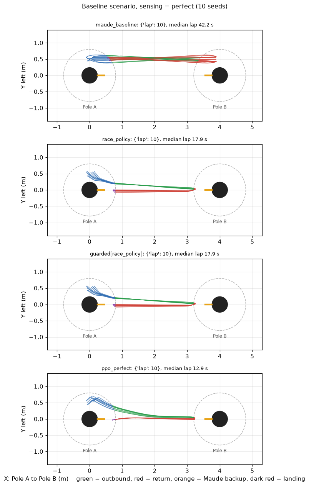
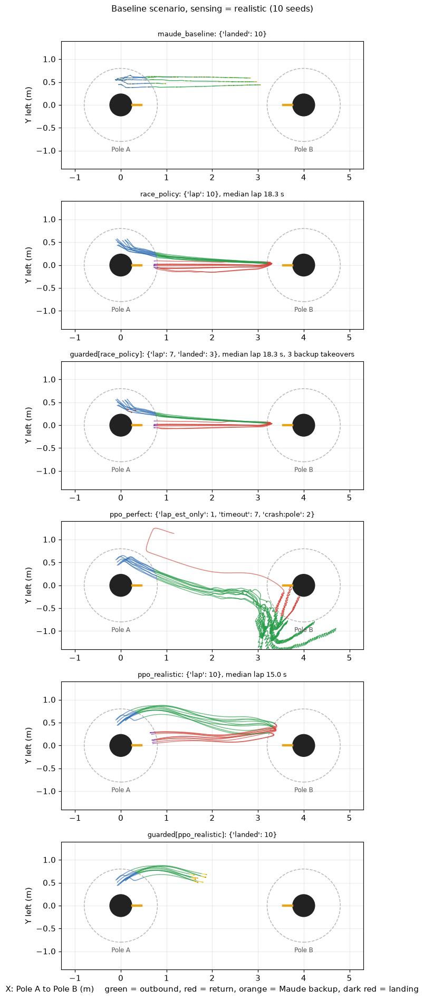
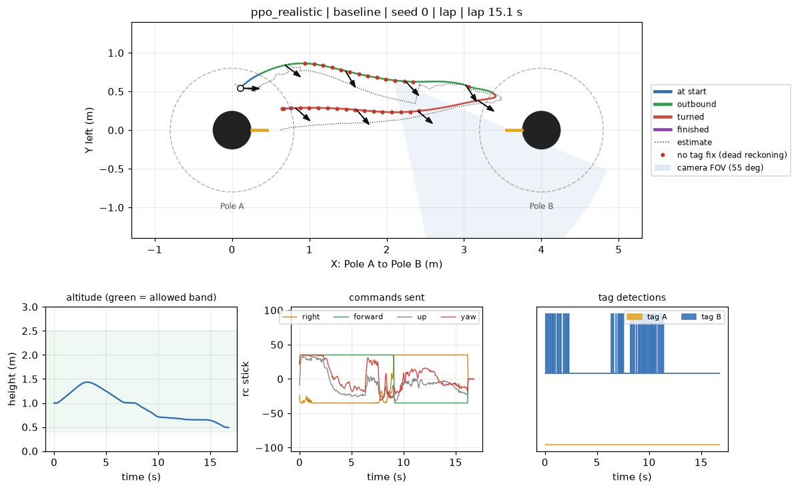
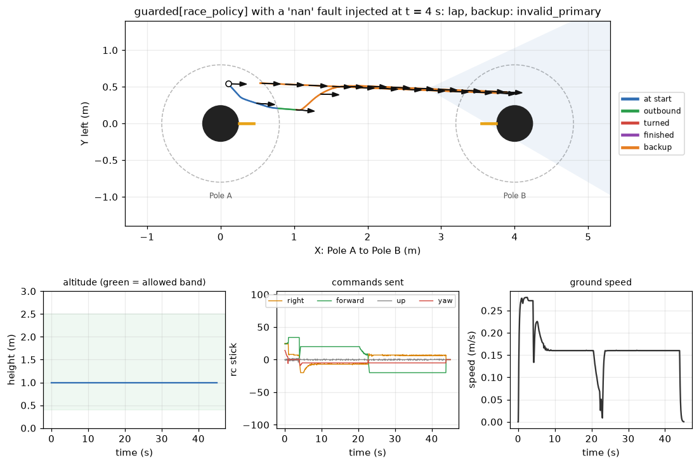
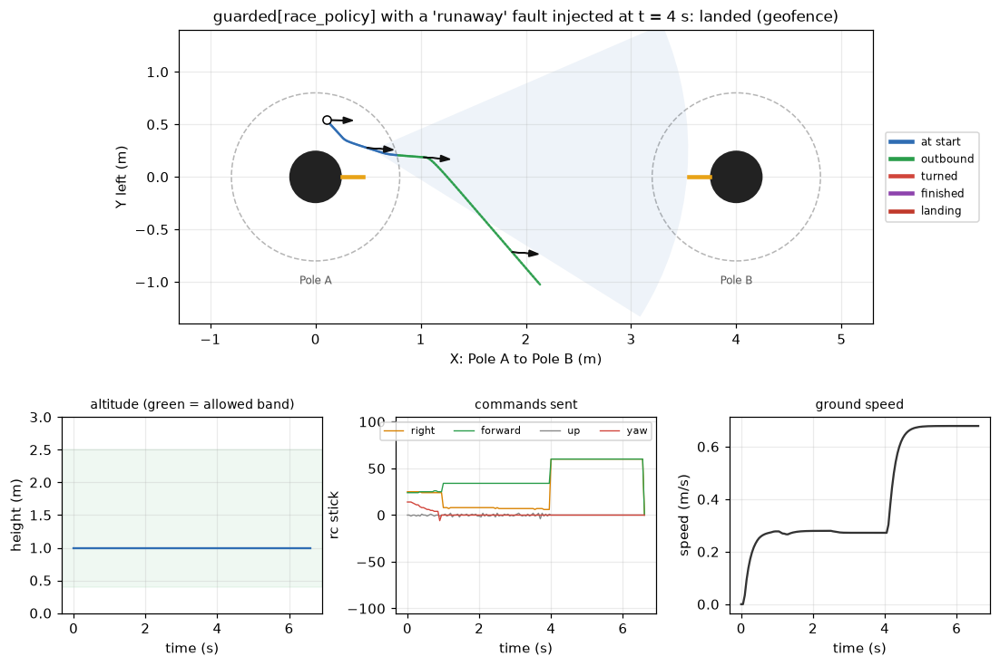
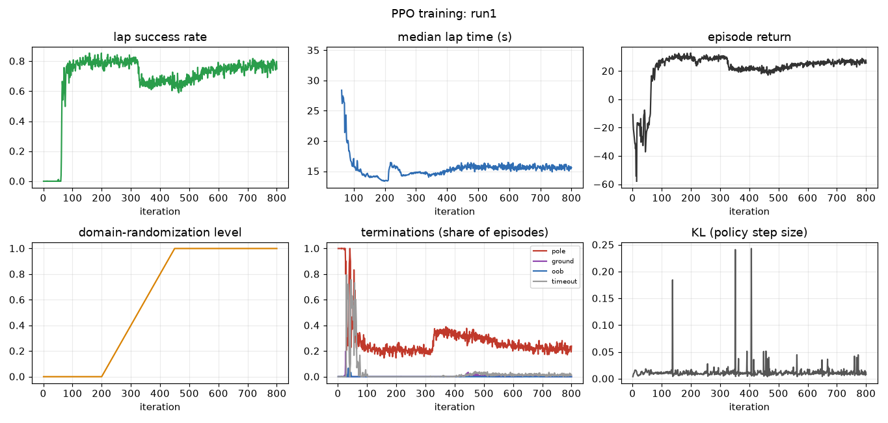
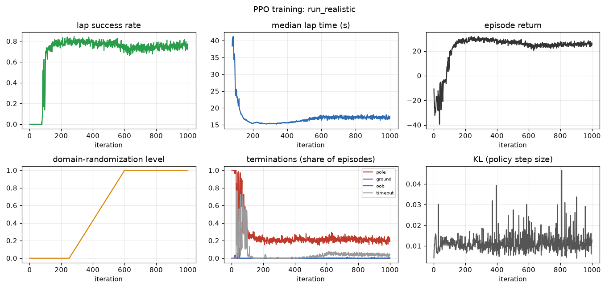

# Simulator test report

Date: 2026-11-01. 30 seeds per cell, 60 s horizon, start states from Maude's stress simulation. All dynamics and sensor
numbers are **placeholders** (see [SIMULATOR_GUIDE.md](SIMULATOR_GUIDE.md)); the results compare policies inside the simulator
and are not predictions for the real drone. Raw numbers: [figures/results.json](figures/results.json). Interactive view:
[figures/replay.html](figures/replay.html).

## Does the simulator meet the four requirements?

| Requirement | Status | Evidence |
|---|---|---|
| **Reasonably realistic** | Partly. Dynamics and perception follow the repo's real camera, tag, filter and stick numbers; all parameters are uncalibrated | 80 tests pass, including exact agreement with Maude's stress simulation (160 of 160 runs) and with the repo's lap timer; sensor tests for field of view, one-sided tags, latency and noise growth. Not yet checked against any real flight |
| **Good visualizations** | Yes | interactive replay with camera cone, estimate vs truth, stick gauges, guard demos; path, outcome, per-run and training figures (below) |
| **RL-compatible (Gym-like)** | Yes | `gym.make("DroneRace-v0")` passes Gymnasium's environment checker; `gym.make_vec` works in both modes; a Stable-Baselines3 PPO run trains on it; the repo's own PPO trains at about 250k steps/s |
| **Close to the actual drone** | Structure yes, numbers unknown | same sticks, 20 Hz, camera model, lap rules and Kalman filter as the real stack; no real data yet to calibrate the speeds, lag, delay or noise |

## Results

### Perfect sensing (the policy sees the true state)

| Policy | baseline | mild-wind | strong-wind | deadband |
|---|---|---|---|---|
| `maude_baseline` | 30 laps (41.8 s) | 30 laps (43.2 s) | 30 timeout | 7 laps, 23 timeout (42.5 s) |
| `race_policy` | 30 laps (17.9 s) | 30 laps (18.9 s) | 30 laps (21.2 s) | 30 laps (18.6 s) |
| `guarded[race_policy]` | 30 laps (17.9 s) | 30 laps (18.9 s) | 30 laps (21.2 s) | 30 laps (18.6 s) |
| `ppo_perfect` | 30 laps (12.9 s) | 30 laps (13.4 s) | 30 laps (14.6 s) | 30 laps (12.9 s) |

### Realistic sensing (camera field of view, tag detections, Kalman filter, dead reckoning)

| Policy | baseline | mild-wind | strong-wind | deadband |
|---|---|---|---|---|
| `maude_baseline` | 30 landed | 30 landed | 30 landed | 30 landed |
| `race_policy` | 21 laps, 9 est-only laps (18.2 s) | 24 laps, 6 est-only laps (19.2 s) | 23 laps, 7 est-only laps (21.4 s) | 22 laps, 8 est-only laps (18.6 s) |
| `guarded[race_policy]` | 19 laps, 8 est-only laps, 3 landed (18.2 s) | 23 laps, 5 est-only laps, 2 landed (19.2 s) | 22 laps, 6 est-only laps, 2 landed (21.4 s) | 20 laps, 7 est-only laps, 3 landed (18.6 s) |
| `ppo_perfect` | 30 timeout | 29 timeout, 1 crash | 1 laps, 3 est-only laps, 26 timeout (17.3 s) | 30 timeout |
| `ppo_realistic` | 30 laps (14.8 s) | 30 laps (15.8 s) | 30 laps (17.2 s) | 30 laps (14.8 s) |
| `guarded[ppo_realistic]` | 30 landed | 30 landed | 30 landed | 30 landed |

"Est-only laps" means the estimate-driven timer (the one a flight would report) finished the lap but the true drone had not
yet entered the gate. The number in brackets is the median lap time.

### What the guard (Maude's policy as backup) does with injected faults

| Injected fault (at 4 s, on `race_policy`) | Without guard | With guard | What the guard did |
|---|---|---|---|
| nan | 30 timeout | 30 lap | backup: invalid_primary |
| stall | 30 timeout | 30 lap | backup: stalled |
| runaway | 30 crash:out_of_bounds | 30 landed |  land: geofence |
| dive | 30 crash:ground | 30 landed |  land: geofence |
| noise | 17 timeout, 7 crash:pole, 6 crash:ground | 12 landed, 2 timeout, 16 lap | backup: backup_path_near_pole, stalled land: backup_path_near_pole, geofence |

The guard leaves a healthy policy unchanged in perfect sensing (identical lap times, tested).

## Findings

1. **A policy trained on true state fails with realistic sensing.** `ppo_perfect` almost never completes a lap (1 true lap and 3 estimate-only
   laps in 120 runs) once it only gets what the camera and filter provide. The realistic-sensing policy (`ppo_realistic`) laps 30 of 30 in every scenario at about 15 s
   (Tvisha's racer: about 18 s; Maude's: about 42 s with perfect sensing). The gap between the two shows why the sensing model matters.
2. **`ppo_realistic` learned to fly blind.** It turns about 65 degrees away from the tags and dead-reckons for up to 6.3 s before
   seeing a tag again. In the simulator dead reckoning is cheap (velocity bias 0.03 m/s), so this works; on the real drone
   the drift may be larger. The guard lands every run of it (no fix for more than 4 s), which is the intended behaviour but
   shows the policy needs a reward for keeping tags in view and wider randomization of the odometry drift before it is trusted.
3. **Maude's PD route cannot be flown on camera sensing alone.** Tag B leaves the 55 degree field of view about 1 m before her
   B waypoint, so her policy lands in all 120 realistic runs. It completes laps with perfect sensing (about 42 s).
4. **The two lap timers disagree.** With realistic sensing the estimate-driven timer finishes the lap up to 1.2 s (mean 0.1 s)
   away from the true timer, and in 9 of 30 baseline runs of Tvisha's racer it fires roughly 0.1 to 0.2 m before the true drone reaches
   the gate (the estimate error is of that size). Whichever timer is authoritative for scoring (plan decision D12) matters.
5. **The guard costs some laps in realistic sensing.** On Tvisha's racer it landed 2 to 3 of 30 runs that would have continued
   (no tag fix for more than 4 s). That is the price of the safety net and the limit can be tuned.
6. **Injected faults are handled.** NaN and stalled outputs hand over to Maude's route and still finish the lap; runaway and
   dive end in a landing instead of a crash; random noise on the sticks, which crashes 13 of 30 runs unguarded, ends in no crashes with the guard
   (12 runs land, 16 still finish the lap).
7. **Tvisha's racer is robust in the simulator but passes close to the poles** (0.32 m from a pole centre at the start, crash
   radius 0.25 m).

## Figures

- Interactive replay: [figures/replay.html](figures/replay.html) (open in a browser; choose a run, scrub, change speed).
- Outcomes:  
- Paths of 10 runs per policy:  
- One run in detail: 
- Guard reacting to a fault:  
- Training:  

## Suggested next steps

See the end of [CONTEXT/KNOWN_ISSUES.md](../CONTEXT/KNOWN_ISSUES.md) and the list given with this report: guard the real flight
runner, record calibration flights, add a tag-visibility reward and wider odometry drift, add sensor-side fault injection to
the sensor model, and agree on which lap timer is official.
